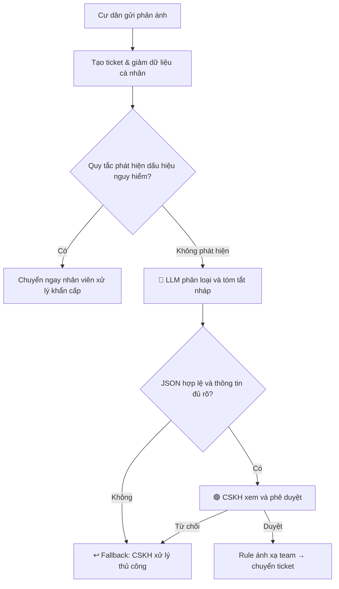

# Lab 02 — Problem Deep-Dive & Evaluation

**Đề tài:** AI hỗ trợ phân loại và điều phối phản ánh cư dân Vinhomes  
**Bối cảnh vai trò:** AI Product Engineer tại Vin Smart Future (bài tập mô phỏng)  
**Phạm vi MVP:** Ticket **văn bản tiếng Việt** do cư dân gửi; phân loại, đánh giá ưu tiên và tóm tắt để CSKH kiểm tra trước khi chuyển bộ phận.

> **Tuyên bố về dữ liệu:** Chưa có quyền truy cập ứng dụng, log, số lượng ticket hay khảo sát nhân viên Vinhomes. Các workflow, mốc thời gian, sản lượng, ví dụ và mục tiêu định lượng trong báo cáo này là **giả định để scoping**, không được diễn giải là kết quả khảo sát hoặc số liệu công bố của Vinhomes. Prototype Python theo slide của giảng viên là bài tập **Xanh SM riêng**, không phải thử nghiệm đã chạy cho đề tài Vinhomes.

## 3.1. Current-State Workflow Mapping

### Đầu vào, phạm vi đo và tác nhân

- **Đầu vào giả định:** Cư dân gửi nội dung phản ánh và mã tòa qua ứng dụng/kênh CSKH; hệ thống tạo ticket.
- **Operator:** Nhân viên CSKH/Ban quản lý cụm tòa nhà.
- **Đầu ra:** Ticket đã được phân loại, tóm tắt và chuyển cho nhóm phụ trách.
- **Thước đo thời gian:** **Thời gian thao tác tiếp nhận và điều phối**, không bao gồm thời gian cư dân chờ trong hàng đợi, thời gian kỹ thuật viên sửa chữa hoặc SLA giải quyết cuối cùng.

| Bước | Actor / Công cụ giả định | Input → Output | Thời gian giả định | Handoff / Bottleneck |
|---|---|---|---:|---|
| 0. Cư dân gửi phản ánh | Cư dân → ứng dụng/tổng đài | Tin nhắn, mã tòa → ticket mới | Không tính | **Handoff 1:** Cư dân/hệ thống → CSKH |
| 1. Mở và đọc ticket | Nhân viên CSKH / màn hình ticket | Ticket mới → hiểu nội dung sơ bộ | **2 phút** | — |
| 2. Xác định loại vấn đề và mức ưu tiên | Nhân viên CSKH / quy ước nội bộ | Nội dung tự do → nhãn sơ bộ | **3 phút** | 🔴 Bottleneck: mơ hồ, nhiều vấn đề, cách diễn đạt khác nhau |
| 3. Xác định bộ phận phụ trách | Nhân viên CSKH / danh sách nhóm xử lý | Nhãn + mã tòa → nhóm dự kiến | **2 phút** | — |
| 4. Viết tóm tắt và ghi chú chuyển giao | Nhân viên CSKH / hệ thống ticket | Tin gốc → nội dung giao việc ngắn | **3 phút** | 🔴 Bottleneck: đọc lại, diễn đạt lại, thiếu thông tin |
| 5. Chuyển ticket | Nhân viên CSKH → nhóm xử lý | Bản ghi hoàn chỉnh → hàng đợi đơn vị | **1 phút** | **Handoff 2:** CSKH → bộ phận kỹ thuật/vệ sinh/an ninh |
| **Tổng** | | | **11 phút/ticket** | **6 phút** tại hai bottlenecks |

**Sơ đồ Current-State:** `04-workflow-diagram.png` (mô tả đầy đủ actor, handoff, thời gian và bottleneck).

**Ví dụ tình huống giả lập:** “Nước rỉ ở trần hành lang tầng 10, ngay gần hộp điện. Nhờ kiểm tra trước khi có người bị trượt ngã.” Tin này chứa nhiều tín hiệu: hạ tầng nước, rủi ro điện và an toàn đi lại. Đây là lý do cần tách **hiểu ngôn ngữ** khỏi **quy tắc xử lý an toàn**.

## 3.2. Problem Statement — 6 Fields

| Field | Nội dung |
|---|---|
| **1. Actor / Operator** | Nhân viên CSKH thuộc Ban quản lý cụm tòa nhà Vinhomes; bộ phận nhận handoff là kỹ thuật điện/nước/thang máy, vệ sinh hoặc an ninh tùy nội dung. |
| **2. Current Workflow** | Sau khi có ticket, CSKH mở và đọc nội dung, tự xác định loại/mức ưu tiên, tra nhóm phụ trách, viết tóm tắt và chuyển ticket. Quy trình 5 bước thao tác, **giả định 11 phút/ticket**. |
| **3. Bottleneck** | Bước phân loại và tóm tắt chiếm **6/11 phút**, vì phản ánh bằng tiếng Việt tự nhiên có thể thiếu từ khóa chuẩn, nhiều ý hoặc sử dụng cách diễn đạt không nhất quán. |
| **4. Business Impact** | **Kịch bản giả định:** 120 ticket/ngày × 11 phút = **1.320 phút = 22 giờ công/ngày** cho khâu tiếp nhận. Nếu giảm còn 4 phút, tiềm năng giải phóng **14 giờ công/ngày** (không đồng nghĩa cắt giảm chi phí lương hoặc doanh thu đã xác nhận). Sai nhóm có thể làm tăng số lần chuyển lại, nhưng chưa có dữ liệu để định lượng. |
| **5. Success Metric** | (a) Thời gian xử lý trung bình **≤4 phút/ticket** thay vì baseline giả định 11; (b) phân loại đúng nhãn chính **≥90%** trên tập ticket có nhãn; (c) đề xuất đúng nhóm phụ trách **≥95%**; (d) **100% ticket** trong pilot được nhân viên duyệt trước khi chuyển; (e) không có thao tác gửi/đóng ticket tự động. |
| **6. Operational Boundary** | AI **được phép** đọc nội dung đã giảm thông tin cá nhân, đề xuất nhãn/ưu tiên và tóm tắt bản nháp. AI **không được** tự chuyển/gửi/đóng ticket, hứa thời gian sửa chữa, tính/miễn phí, chấp thuận bồi thường hay đưa ra quyết định xử lý khẩn cấp. Các tình huống có dấu hiệu nguy hiểm phải được đưa ngay tới nhân viên theo quy trình khẩn cấp hiện có. |

### Cách đo các metrics (đề xuất trước khi pilot)

| Metric | Baseline (giả định, cần đo lại) | Target pilot | Cách kiểm chứng |
|---|---:|---:|---|
| Thời gian CSKH tiếp nhận/điều phối | **11 phút/ticket** | **≤4 phút/ticket** | Log mốc mở ticket → chuyển sau duyệt, so sánh với nhóm làm thủ công |
| Độ chính xác nhãn chính | Chưa đo | **≥90%** | Tối thiểu **200 ticket đã ẩn danh**, hai người gán nhãn đối chiếu, tính top-1 accuracy |
| Đúng bộ phận đề xuất | Chưa đo | **≥95%** | Đối chiếu bản đề xuất với bảng phân công do vận hành xác nhận |
| Hành động tự động không được phép | Chưa có AI | **0 lần** | Kiểm tra log: không có quyền gọi API gửi/đóng ticket trong pilot |
| Ticket được nhân viên duyệt | Quy trình thủ công | **100%** | Theo dõi trạng thái duyệt trước khi handoff |

Các ngưỡng trên là **mục tiêu thử nghiệm**, chưa phải kết quả đạt được. Với phản ánh an toàn, phải tạo bộ test riêng chứa nhiều tình huống nguy hiểm và kiểm tra false negative; độ chính xác tổng thể 90% không thay thế yêu cầu kiểm soát an toàn.

## 3.3. AI Fit: Rule vs LLM vs Agent

| Lựa chọn | Điểm mạnh | Điểm yếu | Kết luận |
|---|---|---|---|
| **Rule / State-Machine** | Nhanh, rẻ, kiểm toán được; rất phù hợp ánh xạ `category → team`, kiểm tra schema và các quy tắc ưu tiên rõ ràng | Dễ bỏ sót cách diễn đạt lạ, câu phủ định và nhiều ý trong một ticket | **Dùng cho bước xác thực, định tuyến và hàng rào an toàn** |
| **LLM Feature** | Hiểu phản ánh tiếng Việt tự nhiên, đề xuất nhãn, tóm tắt và phát hiện trường hợp mơ hồ | Có thể suy diễn, nhầm nhãn hoặc bỏ sót rủi ro; cần giám sát | **Chọn làm thành phần AI chính ở mức hỗ trợ** |
| **Agentic Loop** | Có thể tự gọi công cụ và xử lý nhiều bước dài | Tăng độ phức tạp/chi phí và nguy cơ hành động sai; chưa cần tính tự trị | **Không chọn cho MVP** |

**Kiến trúc chọn:** **LLM Feature + Rule-based + Human-in-the-loop**. Đề tài không yêu cầu một Agent tự vận hành.

### Phạm vi input/output giai đoạn đầu

**Input giả lập:** `ticket_id`, `building_code`, `complaint_text` (đã che số điện thoại, email và các thông tin định danh phù hợp). Không xử lý ảnh, ghi âm hoặc liên kết dữ liệu nhạy cảm trong MVP.

**Output bản nháp minh họa** (chưa có model Vinhomes được chạy):

```json
{
  "ticket_id": "TK-DEMO-001",
  "category": "nuoc",
  "priority": "cao",
  "summary": "Cư dân phản ánh nước rò ở hành lang gần hệ thống điện, cần nhân viên kiểm tra.",
  "suggested_team": "ban_ky_thuat_nuoc",
  "needs_human_review": true,
  "status": "draft"
}
```

Trong thiết kế này, LLM đề xuất `category`, `priority`, `summary`; chương trình **tự ánh xạ nhóm phụ trách bằng bảng rule đã phê duyệt**, không tin trực tiếp một tên bộ phận do LLM tự nghĩ ra.

### Future-State Workflow



**Giả định thời gian Future-State (để kiểm tra tính hợp lý, không phải benchmark):** mở/xem ticket **0,5 phút** + kiểm tra tự động/LLM **0,5 phút** + CSKH duyệt **2 phút** + chuyển ticket **0,5 phút** = **3,5 phút/ticket**, để dư địa so với target **≤4 phút**. Các trường hợp fallback có thể vẫn mất gần 11 phút và phải được tính vào kết quả pilot.

### Operational Boundary & Fallback chi tiết

1. **Chỉ là đề xuất:** AI không có quyền gọi chức năng gửi tin, tự gán/đóng ticket hay thay đổi trạng thái khi chưa có phê duyệt.
2. **An toàn:** Phản ánh như cháy, có khói, người kẹt thang máy hoặc nguy cơ điện giật phải được ưu tiên cho nhân viên. Bộ lọc từ khóa chỉ là lớp hỗ trợ, **không bảo đảm phát hiện hết** mọi ca nguy hiểm; kênh báo khẩn cấp hiện hữu không bị thay thế.
3. **Dữ liệu cá nhân:** Giảm/che thông tin cá nhân trước khi gửi cho mô hình, lưu log tối thiểu; chưa sử dụng dữ liệu cư dân thật trong bài lab.
4. **Không bịa thông tin:** Nếu nội dung không đủ rõ, trả `khac`/yêu cầu kiểm tra thay vì suy đoán số căn hộ, địa chỉ hoặc nguyên nhân kỹ thuật.
5. **Fallback:** Khi timeout, lỗi schema, phân loại không rõ, kết quả mâu thuẫn hoặc nhân viên từ chối đề xuất → chuyển sang thao tác thủ công hiện tại.
6. **Kiểm toán:** Ghi nhận nhãn AI đề xuất, nhãn sau nhân viên sửa và thời gian xử lý để cải tiến; không dùng các log chưa ẩn danh làm bộ dữ liệu công khai.

## 5. EVALUATE — AI Readiness & Decision Quality

| Câu hỏi readiness | Trạng thái hiện tại | Bằng chứng / việc còn thiếu |
|---|---|---|
| Có dữ liệu mẫu/log sạch để test? | **Chưa đủ** | Có thể tự tạo ticket giả lập để thử format, nhưng **chưa có** tập ticket thực tế đã ẩn danh và được gắn nhãn. |
| Rủi ro khi AI sai có kiểm soát được? | **Có thể kiểm soát ở mức thiết kế** | HITL bắt buộc, không cấp API hành động cho LLM, fallback thủ công và quy trình khẩn cấp riêng; vẫn cần test an toàn. |
| Stakeholder sẵn sàng đổi quy trình? | **Chưa biết** | Chưa phỏng vấn CSKH và đơn vị vận hành; cần kiểm tra mức chấp nhận thao tác duyệt. |

### Quyết định chính thức: **NOT YET** cho triển khai vận hành

**Justification:**

- Có lý do kỹ thuật để thử **LLM Feature**: xử lý văn bản tự do và tóm tắt. Tuy nhiên, chỉ dựa trên giả định 11 phút/ticket và 120 ticket/ngày thì **chưa đủ bằng chứng để kết luận lợi ích kinh doanh thực tế**.
- Chưa có tập dữ liệu thật có nhãn, baseline chất lượng, tỷ lệ ticket khẩn cấp hoặc thông tin về việc đội CSKH sẵn sàng áp dụng; do đó chưa thể chứng minh mục tiêu ≥90%/≥95%.
- Chưa có phép so sánh trực tiếp với rule-based baseline. Nếu keyword/rule đã đạt chất lượng tương đương với chi phí thấp hơn, phải ưu tiên giải pháp đơn giản.
- Rủi ro chuyển sai nhóm và bỏ sót trường hợp nguy hiểm cần đánh giá ngoài thử nghiệm định dạng JSON; human review là điều kiện bắt buộc.

**Hành động được phép ngay:** **GO cho prototype offline bằng dữ liệu giả lập** để kiểm chứng schema, prompt, fallback và các trường hợp tấn công. Đây **không phải** quyết định GO triển khai thật.

**Điều kiện để đánh giá lại quyết định:** (1) thu thập tối thiểu 200 ticket đã ẩn danh và có nhãn; (2) đo baseline thời gian từ thực tế; (3) so sánh Rule vs LLM; (4) kiểm thử riêng tình huống khẩn cấp; (5) xin ý kiến CSKH/vận hành; (6) chạy pilot có người duyệt và theo dõi tác động thực.

## Kết luận

**Đề tài phù hợp để tiếp tục nghiên cứu ở phạm vi nhỏ**, vì đầu vào cụ thể, AI Fit hợp lý và ranh giới kiểm soát được ở mức thiết kế. Tuy nhiên, quyết định **NOT YET** là trung thực nhất cho việc đưa vào vận hành khi chưa có dữ liệu thực tế và kết quả pilot.
